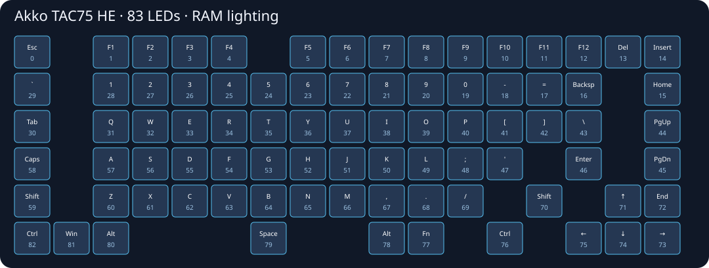

# Akko TAC75 HE — SignalRGB

> **EXPERIMENTAL PRERELEASE — STILL BEING TESTED. USE AT YOUR OWN RISK.** No warranty, promised support, repair, reimbursement or guaranteed recovery. L30k and contributors disclaim liability to the extent permitted by applicable law. Read the [full notice in English and Portuguese](docs/DISCLAIMER.md) before using any file.

Direct per-key lighting for the Akko TAC75 HE, maintained by [L30k](https://github.com/L30k). No bridge application is required while using SignalRGB. Current version: **0.4.0-rc.1**, private experimental review.

[Português](docs/README.pt-BR.md) · [Protocol](docs/PROTOCOL.md) · [Testing](docs/TESTING.md) · [Recovery](docs/RECOVERY.md)



## Experimental: read before installing

This plugin requires the **modified ID2782/V502 RAM1 firmware**. It does not add per-key streaming to stock firmware by itself, and refuses color streaming without the RAM1 capability signature. The firmware modification has only been tried on one owner's keyboard. Basic typing, the three-key color test, return to built-in effects, and continuous effects through the earlier bridge were reported working. This is not general hardware qualification. The direct plugin was loaded in SignalRGB; long-term stability and every physical key position remain unqualified.

Installing experimental firmware can leave a keyboard unable to start. USB restoration requires a reachable bootloader; the supplied updater cannot guarantee recovery. **Do not flash another model or assume a matching USB ID is sufficient.** This repository is not affiliated with Akko or SignalRGB.

## Compatibility

| Item | Target |
| --- | --- |
| Keyboard | Akko TAC75 HE, model K0028 |
| Observed PCB | FUN75_(5088-1049)-3M-RGB, V0.1, 2025-03-03, 507-1FU75-000 |
| Observed MCU marking | RY5088 |
| Runtime identity | Device ID **2782**, version **V502** |
| Modified capability | **AK75RAM1**, protocol 1, 83 LEDs, 544-byte RAM context |
| USB | VID 3151, PID 502D; interface 2, usage page FFFF, usage 2 |
| Tested application | SignalRGB 2.5.80 on Windows |
| Update rate | Fixed **5 FPS** |

Other revisions and firmware versions are untested. Stock Attack Shark plugins or firmware are not interchangeable with this modification.

## Install the plugin — already running RAM1 firmware

1. Stop the old bridge and close the bridge application. Close Akko's configurator and its browser tabs while testing direct control.
2. Exit SignalRGB normally.
3. Copy `plugin/Akko_TAC75_HE.js` to your Windows Documents folder under `WhirlwindFX/Plugins`. Keep only one TAC75 plugin in that folder. Back up old plugins outside the Plugins directory.
4. Start SignalRGB. The keyboard should appear as **Akko TAC75 HE**, publisher **L30k**.
5. Enable **Enable per-key lighting (5 FPS)** on its device page. No separate application is needed.
6. Disable the control or exit SignalRGB normally to release lighting back to the built-in effects.

The plugin streams RGB into RAM. Its code contains no firmware-update, configuration-save, or flash-programming commands. A force-killed SignalRGB process may leave the last colors displayed until another release command or a keyboard power cycle. This is not a firmware-level timeout.

### Where are the drawn keys?

The SignalRGB **Layout** page displays a device as a rectangle. Its documented plugin exports provide LED positions/names and a device-list image, not a keycap-shaped canvas renderer. Use **Devices → Akko TAC75 HE → Lighting → Paint LEDs** for individual LEDs. This plugin registers all 83 LEDs and standard key names explicitly. The SVG above and `assets/led-map.json` show the physical index map; keycap widths are schematic, not measured geometry.

Documentation: [Layouts](https://docs.signalrgb.com/guides/device-configuration/about-layouts/), [LED exports](https://docs.signalrgb.com/developer/plugins/plugin-exports/), [key names](https://docs.signalrgb.com/developer/plugins/key-names/).

## Firmware development — stock V502 users

**Do not install firmware just to try the plugin without a recovery plan.** Firmware construction and the manual updater are provided for developers, not as a verified consumer update.

Vendor firmware binaries are not redistributed in this source package. Obtain your exact official base locally; it must match `firmware/base.json`. The download helper checks its decoded length and SHA256 before writing a file and never opens USB:

```text
python -m pip install -r app/requirements-development.txt
python tools/prepare_base.py --download
python firmware_tools/build_firmware.py
python tests/emulate_firmware.py
python tests/emulate_boot_transfer.py
python -m unittest discover -s tests -p "test_*.py"
```

Alternatively, provide an already downloaded base with `python tools/prepare_base.py --file PATH`.

The full firmware emulator can take several minutes. Run the updater only after reviewing [recovery limitations](docs/RECOVERY.md) and the generated validation results. `python app/app.py` launches the manual updater; merely launching it does not flash. It requires an exact `ID2782` confirmation for an update. There is no automatic recovery or automatic flash on launch. The English firmware manager remains an experimental developer tool. It is not required while using the plugin.

On Windows, `python tools/build_manager.py` creates `dist/TAC75_Firmware_Manager.exe` with the locally verified firmware pair. The source-only archive does not include those vendor images. See [architecture and folder organization](docs/ARCHITECTURE.md), [release notes](release/v0.4.0-rc.1.md) and [changelog](CHANGELOG.md).

The patch builder preserves the bootloader bytes, adds the RAM receiver, changes two code paths and three heap/stack limit words, and reduces reserved stack by 544 bytes. Preserving bootloader bytes is not proof that it can be entered when application code hangs. See the detailed [firmware validation report](docs/firmware-validation-pt.md).

## Tests

```text
node tests/test_plugin.cjs plugin/Akko_TAC75_HE.js
```

The JavaScript suite uses a simulated device: it does not open USB or change a keyboard. See [TESTING.md](docs/TESTING.md) for limits and the distinction between owner observations, software tests and hardware qualification.

## Contributing

Report your device ID, firmware version, PCB revision, SignalRGB version, exact steps and sanitized plugin-console errors. Do not post your serial number, Windows account paths, USB location identifiers or full device logs. Never attach another model's firmware as a proposed fix. See [CONTRIBUTING.md](CONTRIBUTING.md).

## Credits and ownership

Original project code is licensed under MIT; vendor firmware and trademarks are excluded. The device image URL points to a photo hosted by Akko; it is not included or relicensed here. See [THIRD_PARTY_NOTICES.md](THIRD_PARTY_NOTICES.md).
